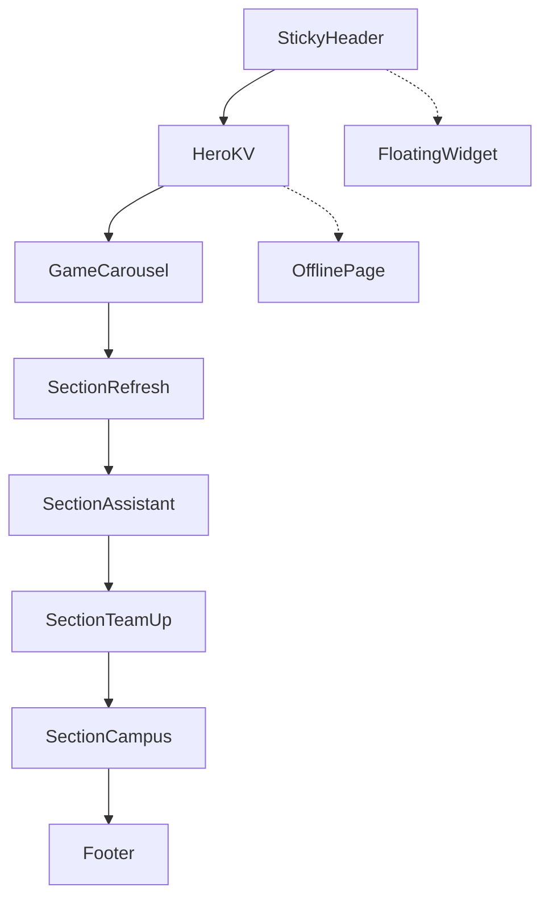

# Architecture

技术栈、路由与目录。新建文件前先对照本文。

## 技术栈

- Vite
- React
- TypeScript（`strict`）
- Tailwind CSS
- React Router
- vite-plugin-pwa

版本用脚手架当时的当前稳定版，不锁死文档里的 minor。无后端，无全局状态库；跨组件状态用 props 或局部 hook。

EN: Vite, React, TypeScript strict, Tailwind, React Router, vite-plugin-pwa. Use current stable versions at scaffold time. No backend and no global store.

## 路由

- `/` 重定向到 `/home`
- `/home` 首页
- `/store` 商店占位页
- `/offline` 断网说明页（无顶栏布局，已注册）

未知路径重定向到 `/home`。部署时所有路径回落到 `index.html`。

P2 定位与货币不做独立路由，见 `AppLayout` 中的 `FloatingWidget`。

EN: `/` redirects to `/home`. Routes are `/home` and `/store` today; add `/offline` with PWA. Unknown paths redirect home. Hosting must fall back to `index.html`. Geolocation/currency is the global floating widget, not `/locale`.

## 目录

```
src/
  app/router/                 路由表与 paths.ts，路径的唯一来源
  layouts/AppLayout.tsx       顶栏、右侧锚点（仅首页）和 Outlet
  providers/                  跨布局和页面共享的状态，如首页当前屏
  pages/                      页面入口，只放该页内容
  components/layout/Footer.tsx
  components/layout/SideNav.tsx  右侧锚点，跟顶栏一样属于布局，不放进首页区块
  components/layout/header/   Header、HeaderSearch，以及 desktop/、mobile/
  components/home/<block>/index.tsx  每个首页区块一个目录，入口是 index.tsx
  components/shared/          Button, Dropdown、FloatingWidget（P2）等复用件
  api/                        少量前端 API 封装（如 home/locationDetact.api.ts）
  data/                       mock，按区块一个文件。菜单引用 app/router/paths，不自己定义路径
  hooks/                      跨组件的可复用 hook。整屏滚动、useDebounce、useThrottle 在这里
  utils/debounce.ts           停手后再执行，带 cancel
  utils/throttle.ts           一段时间内最多执行一次，带 cancel
public/
  images/ videos/             首页静态资源
  icons/                      PWA 图标（P0 待补齐）
```

路径只写在 `app/router/paths.ts`。`app/router` 用布局路由包住页面，顶栏不在每个页面里重复。页面只组合自己的区块，区块从 `src/data` 取数。定位请求与面板状态在 `FloatingWidget` + `api/home/locationDetact.api.ts`，不放进首页区块组件。

EN: Paths live in `app/router/paths.ts`. `app/router` wraps pages in a layout route, so the header is not repeated. Pages compose their own sections. Sections read `src/data`. Location/currency lives in the floating widget and `api/home`, not under `features/locale`.

## 数据

首页文案、海报、链接、页脚全部来自本地 mock。类型与数据放在一起。搜索只过滤本地海报标题。下载按钮指向 mock URL，不触发真实安装包逻辑。

EN: All home copy, posters, links, and footer data are local mocks. Search filters local titles only.

## 页面流



## 边界

- 网络图片失败：显示占位，不白屏
- Service Worker 只缓存应用壳与离线页，不缓存第三方接口
- 不要把定位面板写进单个首页区块；P2 已用布局级 `FloatingWidget` 承载

EN: Failed images show a placeholder. The service worker caches the app shell and offline page only. Keep location UI in the layout floating widget, not inside home section components.
